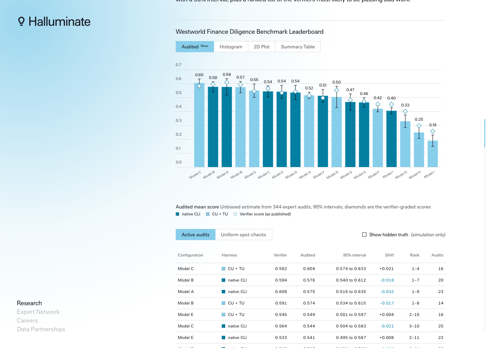

# Audited leaderboard for Westworld Finance Diligence Bench

**Live demo:** https://mohith26.github.io/halluminate-audited-leaderboard/

A concept feature for Halluminate's benchmark reports: an **Audited** tab on the Westworld Finance Diligence Bench leaderboard that turns a small number of expert spot-checks into an unbiased score with a 95% interval for every model and harness, chooses which attempts experts should audit next, and ranks the agentic verifiers most likely to be passing bad work. Most of a task's weight sits on agentic rubric checks (95% in the post's sample task), the post's QA section shows verifiers that pass hollow work, and press coverage noted the headline numbers "have not been independently validated". With **300 expert audits (6.3% of 4,752 attempts)** the intervals are **±0.035**, **3.77x narrower** than averaging the expert grades alone, and they covered the hidden truth **95.2%** of the time over 200 replays.

## What it does

- **Audited tab** next to Histogram / 2D Plot / Summary Table, drawn with the post's own chart conventions: audited score per configuration with a 95% interval, the published verifier score as a diamond, shift, a rank interval (normal-approximation draws) and the audit count, sortable by audited score. A "show hidden truth" switch exists only because this is a simulation.
- **Drill-down:** click a column or row for that configuration's audits (verifier vs expert per attempt, expert-minus-verifier by task category); click an attempt for every check's weight, both judges' verdicts and the expert grade, with false passes and false fails marked.
- **Next expert batch:** the attempts the active policy will send to experts, with inclusion probabilities and predicted error; **Approve batch** reveals their expert grades and every interval updates; undo, reset, and CSV export of the queue (the inclusion probabilities travel with it because the estimator needs them).
- **Verifier triage:** agentic checks ranked by the posterior probability that their false-pass rate exceeds 20%, with the audited fails behind each estimate; exportable.
- **Efficiency figure** (the post's line-figure component, with Focus toggles): interval width against expert audits for four methods.
- Deep links (`#tab=audited&batches=5&strategy=active&seed=7&config=1&attempt=...&check=...`), audit state saved in localStorage, keyboard (`a` approve, `u` undo, `e` export, `Esc` close, arrow keys on tabs), loading and error states.

## How it works

Each attempt's verifier score is a weighted sum of check verdicts; its true score is what an expert would award. An expert audit of an attempt reveals the true outcome of its agentic checks (deterministic checks are exact).

1. **Calibrated prediction.** Each agentic check has a false-pass and a false-fail rate for the production judge and for a cheaper second judge (Beta posteriors from audits so far, partially pooled toward the check's family). Bayes turns the two verdicts into the probability the check truly passed, so every attempt gets a predicted expert score and a predicted error.
2. **Active allocation.** Before each batch, attempts are drawn by Poisson sampling with probability proportional to predicted error (Neyman allocation) mixed with a uniform floor; the first batch is a uniform pilot.
3. **Estimator.** For each configuration and batch: exact true scores of attempts already audited, plus predictions for the rest, plus the inverse-probability-weighted sum of (expert minus prediction) over the batch. Predictions and probabilities are fixed before the batch is drawn, so each batch estimate is unbiased whatever the posteriors are; batches are combined with weights fixed in advance and their errors are martingale differences, so variances add. This is the difference / prediction-powered estimator with design-based active sampling.
4. **Triage** ranks checks by P(false-pass rate > 20%) under the Beta posterior.

Everything runs in the browser (`src/audit.js`, no dependencies) in about 20 ms per state.

## Results (synthetic replica, 40 simulated audit runs per cell)

| Method | 120 audits | 300 audits | 600 audits | Coverage at 300 |
|---|---:|---:|---:|---:|
| Expert audits only (mean of expert grades) | ±0.215 | ±0.132 | ±0.089 | 91.0% |
| Raw verifier + uniform audits (difference estimator / PPI) | ±0.070 | ±0.047 | ±0.033 | 90.7% |
| Calibrated verifier + uniform audits | ±0.059 | ±0.038 | ±0.027 | 95.1% |
| Calibrated verifier + active audits (this) | ±0.056 | ±0.035 | ±0.024 | 94.3% |

At 300 audits the active method is 26% narrower than correcting the raw verifier with uniform audits, which needs about 548 audits to match it; mean absolute error 0.015. In the replica the published verifier scores overstate the truth by 0.023 on average (up to 0.057) and 4 configurations sit at a different rank. In the default page state (seed 7, 5 batches, 344 audits) 17 of 18 intervals cover the truth and 4 of the top 10 triaged checks are among the 35 simulated weak checks.

## Data

`scripts/generate.mjs` writes `data/bench.json`, a seeded replica with the published benchmark's shape: 88 tasks in the post's 7 categories (Modeling 14, Underwriting 13, Quality of earnings 9, Data preparation 11, Pitch materials 15, Closing 4, Diligence review 22), 18 model-by-harness configurations with 3 attempts each, 3-8 agentic and 1-3 deterministic checks per task (agentic weight share 70-95%), and each configuration's ability calibrated so that its verifier-graded mean equals the published leaderboard value. Configurations are anonymized (Model A-I) because the expert grades, judge error rates (most around 5-7%, about 7% of agentic checks "weak" with 35-70% false passes, inspired by the post's keyword-verifier examples) and the second judge are simulated. The Histogram, 2D Plot and Summary Table tabs show the published numbers with model names replaced.

## Run it

    node scripts/generate.mjs     # rewrite data/bench.json (deterministic)
    node scripts/report.mjs       # rewrite results/results.json (about 10 s)
    node --test test/audit.test.mjs
    python3 -m http.server 8000   # then open http://localhost:8000

No build step. The CI workflow is in `ci/test.yml` (move it to `.github/workflows/` to activate; the publishing token here lacks the `workflow` scope).

## Tests

16 tests: the committed data equals the seeded generator's output byte for byte on any platform (`src/detmath.js` implements exp/log/sin/cos with only correctly rounded IEEE operations, because V8's `Math.exp`/`Math.log` can differ in the last bit between macOS arm64 and Linux x86-64; a test pins exact values and checks they stay within 2 ulp of `Math.*`); the shape and the verifier-graded means match the post; auditing everything recovers the truth exactly; **property tests** that the active and the uniform estimators are unbiased over 150 seeded runs each; inclusion probabilities hit the batch size, stay in (0, 1] and are monotone; posterior counts; predictor identity when judges agree with zero error; Beta tail against closed forms; rank intervals with zero error; audit-queue ordering; triage ordering; and the **headline** (3.77x, coverage, half-width recomputed with the report's seeds) plus the default page state.

## Limitations

- Synthetic. Expert grades, judge error rates and the second judge are simulated; only the benchmark's shape and the verifier-graded means come from the post. On real data the gains depend on how predictable verifier errors are.
- The second judge is an assumption (a cheaper model re-grading the same rubric item); without it the calibrated predictor helps much less. On weak checks the two judges' errors are correlated in the simulation, as a badly specified rubric would make them.
- Experts are treated as ground truth. Disagreement between experts is not modelled.
- The estimand is the mean over the 264 graded attempts of each configuration (the leaderboard's own definition), not a population of future tasks; task sampling uncertainty is not included.
- Normal-approximation intervals; with very few audits per configuration (under about 10) they can under-cover.
- Rank intervals treat configuration estimates as independent.
- Triage needs several audited fails per check before it separates weak checks from noise; at 300 audits it is a prioritization aid, not a verdict.

## Prior art and what is new

Prediction-powered inference (Angelopoulos et al., Science 2023) and PPI++ (2024), active statistical inference (Zrnic and Candes, ICML 2024), and the survey-sampling difference and Horvitz-Thompson estimators they build on; LLM-judge calibration and judge-bias correction in evaluation (for example, Boyeau et al. 2024 on PPI for model evaluation). Halluminate's own post audits verifiers with agents and a core team and reports a variance decomposition, but publishes no verifier error rates or intervals. What is new here is packaging these methods for a mixed agentic/deterministic verifier pipeline: per-check judge error posteriors with two judges, attempt-level Neyman allocation under a batch workflow, a design-unbiased leaderboard with intervals, and verifier triage, inside the leaderboard figure itself.

---
Unofficial concept demo by Mohith Gajjela. Not affiliated with Halluminate. Synthetic data; published scores from halluminate.ai/blog/due-diligence-bench with model names anonymized. Page styles reuse halluminate.ai's stylesheet and the post's figure styles so the feature reads as part of the report. Code under the MIT license.
